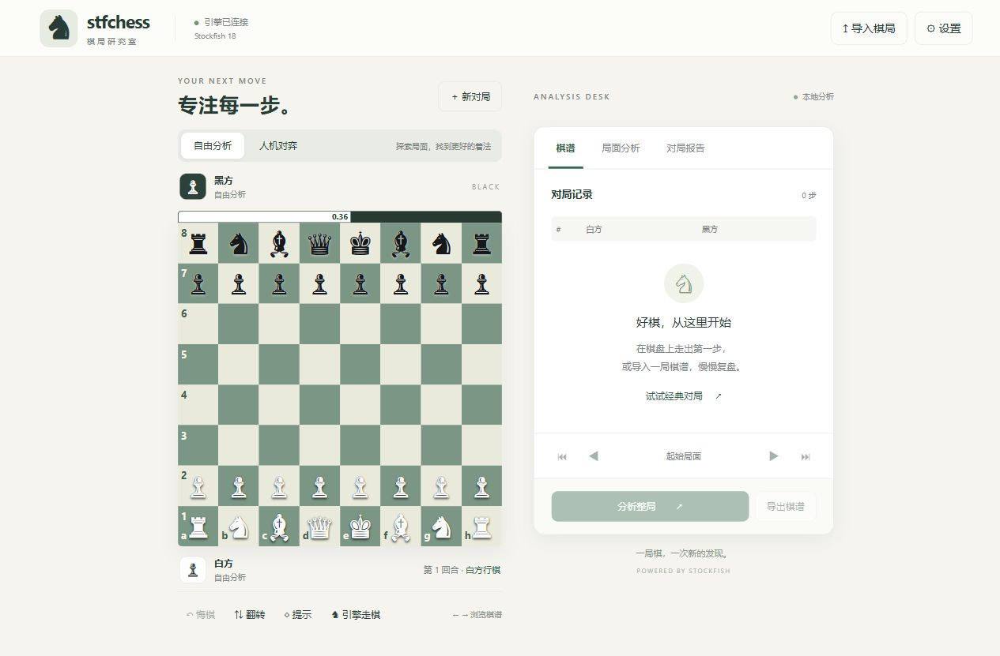

# stfchess — 国际象棋棋步/棋局分析工具

基于 **Stockfish 18** 引擎 + FastAPI 后端 + 纯原生前端（无外部 CDN 依赖）的本地棋局分析工具。

## 界面

首页以棋盘为中心，右侧通过「棋谱 / 局面分析 / 对局报告」切换信息。导入 PGN、FEN 和偏好设置在独立弹窗中打开，手机端改为上下排列。

导入只加载棋局；需要逐步评分与准确率时，点击「分析整局」，可随时取消。切换局面或开始新对局后，旧的走棋、评估和分析请求不会覆盖新棋局。



[查看手机界面](docs/screenshots/mobile.jpg)

## 功能

- **交互棋盘**：点击走子或**鼠标左键直接拖拽**（只能落在合法位置，非法落点自动弹回；含升变、王车易位、
  吃过路兵），棋子滑动动效（吃子淡出、易位车同步滑动）、翻转棋盘、悔棋、导航（←/→ 键）
- **实时着法评价**（可开关，默认开）：每走一步，评价徽章显示在走子棋子右上方
  （最佳/优秀/良好/不精确/错误/大错，约 2.5 秒后淡出）
- **音效**（可开关，默认开）：走子、吃子、将军、将杀四种提示音（Web Audio 合成，无外部音频文件）
- **实时引擎评估**：每步自动分析当前局面，评估条 + 前 3 条最佳变着（SAN 记谱，带深度）
- **整局分析**：导入 PGN 或直接走子后一键分析，输出每步
  - 引擎推荐着法与实际着法的评估对比、厘兵损失
  - 着法分类：最佳 / 优秀 / 良好 / 不精确 / 错误 / 大错（棋盘右侧棋谱着色标注）
  - 双方准确率（Lichess 公式）与分类统计
  - 评估曲线（可点击/悬停跳转到对应局面）
- **人机对弈**：勾选后引擎自动应答，四档棋力（入门/业余/大师/特级），引擎可执白或执黑；
  默认白方在棋盘下方，人类执黑（引擎执白）时自动翻转让黑方在下方
- **提示**：在棋盘上画出引擎推荐着法箭头
- **导入导出**：粘贴 PGN / FEN 载入；导出带评注（`[%eval]`、NAG 符号、中文评语）的 PGN

## 运行

- **网页版**：双击 `start.bat`（127.0.0.1:8134 并打开浏览器）
- **局域网版**（手机可访问）：双击 `start-lan.bat`，手机浏览器打开提示的地址
- **Windows 桌面版（exe）**：双击 `dist\stfchess\stfchess.exe`（自带图标、无终端弹窗；
  `stfchess.exe --server` 为无窗口服务器模式）
- **安卓版（APK）**：安装 `android\stfchess-android.apk`（arm64，Android 7+）——Java 原生壳 +
  内置 HTTP 服务 + 官方 Stockfish，**完全离线、装上即用**，前端与桌面版同一套
- 重新构建：桌面 `build_exe.bat`；安卓 `tools\build_apk.py`（需本目录 tools/ 下的 JDK 与
  Android build-tools，需事先准备工具链，见下文）

### 从源码跑起来（克隆后）

```bat
git clone https://github.com/B-lackLuster/stfchess.git
cd stfchess
python tools/get_engines.py            :: 下载 Stockfish 18 引擎（~154MB，官方 release）
python -m venv .venv
.venv\Scripts\python -m pip install -r requirements.txt
start.bat
```

安卓 APK 请用 `tools\build_apk.py` 自行构建（依赖 JDK 17 与 Android build-tools 34，
详见脚本开头的依赖清单；缺少依赖时脚本会列出具体路径）。

### 构建与验证

Windows 桌面构建先安装 `requirements-desktop.txt`，再运行 `build_exe.bat`。

安卓工具链默认位于项目的 `tools/` 和 `downloads/android/`。如果另一份工作目录已有工具链，可设置 `STFCHESS_TOOLCHAIN_ROOT` 为那个项目根目录，输出仍写入当前项目。签名保存在 `android/debug.keystore`，也可通过 `STFCHESS_KEYSTORE` 指定已有签名；请保留该文件以便覆盖安装。APK、签名及构建中间文件不提交到 Git。

```bat
.venv\Scripts\python -m pip install -r requirements-dev.txt
.venv\Scripts\python -m unittest discover -s tests -v
node --test tests/frontend.test.cjs
```

Python 回归测试覆盖 PGN/FEN、特殊走法、评分与导出；引擎集成测试在本地有引擎时运行，否则明确跳过。Node 测试覆盖切换棋局、取消任务后丢弃旧请求，以及单条变着不覆盖三条变着缓存。

安卓核心可在 JVM 上执行 `android/src/TestCore.java` 的回归检查（使用与构建脚本相同的 jar 依赖）。APK 构建成功不代表已在安卓真机上验证。

`android/src/TestAndroidServer.java` 进一步验证安卓 Java 服务的 HTTP 接口。编译后传入 APK 路径和主机可执行的 Stockfish 路径；测试直接从 APK 读取前端资源，覆盖走棋、多变着、人机应答、带嵌套变着的 PGN、无效 FEN、整局分析与取消。它在主机 JVM 上运行，不能代替手机上的安装、WebView 和 ARM64 引擎启动验证。

`python tools/verify_android_apk.py` 检查 APK 的 ZIP 完整性、前端资源与源码是否一致、引擎的 ARM64 架构，以及 DEX 中已知不兼容 Android 7 的方法引用。APK 签名需另用 `apksigner verify` 验证。

## 目录结构

```
stfchess/
├── engines/avx2/stockfish/stockfish-windows-x86-64-avx2.exe   # Stockfish 18 主引擎
├── engines/baseline/stockfish/stockfish-windows-x86-64.exe    # 备用（无 AVX2 时自动使用）
├── engine_manager.py    # UCI 引擎进程管理（线程安全封装）
├── analysis.py          # 逐步评估、着法分类、准确率、PGN 解析/导出
├── server.py            # FastAPI 接口 + 后台整局分析任务
├── desktop.py           # 桌面模式（pywebview 原生窗口）与 --server 模式
├── paths.py             # 开发/打包环境路径解析
├── static/              # 前端（原生 HTML/CSS/JS，桌面/安卓共用）
├── dist/stfchess/       # Windows exe 构建产物
├── android/             # 安卓版：Java 源码（stfchess.core + MainActivity）、
│                        #   stfchess-android.apk 产物、apk_build/ 中间产物
├── tools/               # 构建脚本与工具链（JDK、Android build-tools）
├── start.bat / start-lan.bat / build_exe.bat
└── README.md
```

## 安卓版架构

`android/src/stfchess/core` 是纯 Java 核心（在桌面 JVM 上先行测试过再进 APK）：
- `UciEngine.java` — Stockfish 进程封装（分析/走子/Skill Level）
- `ChessCore.java` — 规则（chesslib）、SAN 生成、着法分类、Lichess 准确率、PGN 解析/导出
- `ChessServer.java` — NanoHTTPD 内置服务，提供与 Python 版**完全相同**的 /api 接口

`MainActivity` 只做两件事：把官方 Stockfish android-armv8 二进制（打包在 APK 的
`lib/arm64-v8a/libstockfish.so` 里，系统自动释放为可执行文件）跑起来，然后开 WebView
加载内置服务。引擎默认使用手机一半核心 + 128MB 哈希。

## 主要 API

| 方法 | 路径 | 说明 |
|---|---|---|
| GET  | `/api/health` | 引擎状态 |
| POST | `/api/position/moves` | 某局面的全部合法着法 |
| POST | `/api/position/move` | 走一步（返回 SAN/新 FEN/对局状态） |
| POST | `/api/position/analyze` | 分析局面（多 PV） |
| POST | `/api/engine/move` | 引擎走一步（按棋力档位） |
| POST | `/api/games/parse` | 解析 PGN |
| POST | `/api/games/analyze-job` | 启动整局分析后台任务 |
| GET  | `/api/jobs/{id}` | 查询任务进度/结果 |
| POST | `/api/games/export` | 导出带评注 PGN |

## 分析口径

- 每步损失 = 引擎对该局面给出的最佳评分 − 实际走子后的评分（行棋方视角，杀棋按距离折算）
- 分类阈值（厘兵损失）：最佳(≤1 或与引擎一致)、优秀(≤10)、良好(≤25)、不精确(≤50)、错误(≤100)、大错(>100)
- 准确率采用 Lichess 的胜率差公式（`win% = 50 + 50·(2/(1+e^(-0.00368208·cp))−1)`）
- 默认分析深度 12，单局面时间上限 2.5s；整局分析默认深度 12、每局面上限 2s，可在界面调节

## 安卓使用规划

| 阶段 | 方案 | 状态 |
|---|---|---|
| 1 | **离线 APK（已实现）**：`android\stfchess-android.apk` — Java 原生壳 + 内置 HTTP 服务 + 官方 Stockfish armv8，装上即用、完全离线 | ✅ |
| 2 | 局域网访问：PC 跑 `start-lan.bat`，手机浏览器打开 `http://电脑IP:8134`（前端已支持触屏拖子） | ✅ 已就绪 |
| 3 | PWA：manifest + Service Worker，「添加到主屏幕」全屏运行 | 未做，小工作量 |
| 4 | 原生重写（Kotlin/Compose 或 Flutter + SF 插件）上架应用商店 | 长期可选 |

安装说明：把 `android\stfchess-android.apk` 传到手机（微信/数据线/网盘均可），点击安装并允许
「未知来源应用」。要求 **arm64 设备、Android 7.0+**（近十年的手机基本都满足）。
首次启动会闪一下引擎初始化，之后与桌面版功能一致：走子/拖拽、实时评价徽章、音效、
整局分析、人机对弈、PGN 导入导出，全部离线可用。
